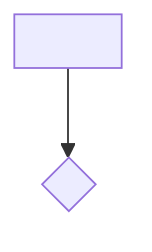
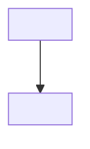

# documenter

Mantiene el árbol `knowledge/` del proyecto: arquitectura, stack, convenciones, decisiones, y **módulos** que agrupan use-cases (cada use-case con spec/flow/decisions/notes). **Humano en el loop por default** — propone ediciones, no reescribe sin confirmación.

Complementa (no reemplaza):
- **Graphify** (`graphify-out/`) — fuente de verdad para *estructura* del código. Todo lo que el grafo responde no vive acá.
- **OpenSpec** (`openspec/`) — workspace efímero de la feature en curso. El archive es cold storage.

## Usage

```
/documenter bootstrap          # crea el árbol (INDEX global + modules/) si no existe
/documenter update             # detecta drift vs git log, propone edits
/documenter distill <id>       # lee openspec/changes/archive/<id>/ y propone edits
```

---

## Invariants

1. Nunca escribir fuera de `knowledge/`.
2. Nunca tocar `documentation/` ni `openspec/`.
3. Nunca reescribir archivos sin confirmación del usuario (salvo en `bootstrap` cuando el target no existe).
4. **Regla divisoria:** antes de proponer escribir algo, verificar que Graphify no lo responda ya. Si el grafo lo sabe, no duplicar.
5. Si no hay fuente para una aserción, dejar `<TODO>`. Nunca inventar.
6. **Convención de naming capability ↔ use-case (regla 1:1):** el slug del capability en
   `openspec/specs/<capability>/` debe coincidir 1:1 con el nombre del directorio del use-case, que vive
   **anidado bajo un módulo**: `knowledge/modules/<module>/use-cases/<capability>/`. El slug del capability
   es **único globalmente** (lo garantiza `openspec/specs/` plano), así que el módulo es solo *dónde* vive
   ese use-case. Distill **resuelve la ubicación por glob** `knowledge/modules/*/use-cases/<capability>/`
   (ver [Resolución de ruta del use-case](#resolución-de-ruta-del-use-case)) — la **ubicación es la
   membresía**, no hay frontmatter `module:`. Si el change introduce un capability nuevo, el use-case se
   crea con el mismo slug bajo el módulo que se resuelva.

---

## Detección de raíz

1. Partir del `cwd` actual.
2. Subir directorios hasta el primero que contenga `package.json` o `CLAUDE.md` o `.git`.
3. Si hay ambigüedad (monorepo), listar candidatos y preguntar.
4. Todas las rutas `knowledge/...` se resuelven contra esa raíz.

---

## Layout objetivo

```
knowledge/
├── INDEX.md                 # índice de módulos (entry point — ver "Archivo INDEX.md global")
├── architecture.md          # overview narrativo corto
├── stack.md                 # runtime, deps clave, por qué
├── conventions.md           # código y proceso
├── decisions.md             # decisiones arquitecturales macro
├── business-context.md      # negocio, restricciones, lore macro
├── external-refs.md         # registry de libs
├── _reports/                # output de lint
└── modules/                 # capa de navegación por dominio; contiene los use-cases
    ├── _unsorted/           # módulo reservado: use-cases nuevos sin módulo resuelto (mover con `git mv`)
    │   └── use-cases/
    └── <module>/
        ├── INDEX.md         # resumen + diagrama + "¿Qué quiero hacer?" (intent→flow) + notas transversales + relacionados
        └── use-cases/
            └── <capability>/
                ├── spec.md          # contrato narrativo (QUÉ debe cumplirse), sincronizado con openspec/specs/<capability>/
                ├── flow.md          # flujo funcional end-to-end (CÓMO funciona y POR QUÉ) + diagrama Mermaid. Veredicto obligatorio.
                ├── decisions.md     # decisiones implementadas (POR QUÉ se eligió X). Opcional, solo si hay.
                └── notes.md         # lore, gotchas, TODOs no-derivables
```

El **módulo** es la unidad de navegación/dominio (agrupa N use-cases); el **use-case** es la unidad de
contrato/cambio (1:1 con `openspec/specs/<capability>/`). La ubicación del directorio del use-case codifica
a qué módulo pertenece — ver [Resolución de ruta del use-case](#resolución-de-ruta-del-use-case).

---

## Resolución de ruta del use-case

El use-case de un capability vive en **una sola** ruta: `knowledge/modules/<module>/use-cases/<capability>/`.
Como el slug del capability es **único globalmente** (`openspec/specs/` es plano, sin anidar), se resuelve
la ruta por **glob**, no por construcción determinística:

```
glob knowledge/modules/*/use-cases/<capability>/
```

| Hits | Significado | Acción |
|---|---|---|
| **0** | Capability nueva | Resolver módulo (abajo) y crear `knowledge/modules/<module>/use-cases/<capability>/` |
| **1** | Capability existente | Actualizar **in situ** (el módulo es donde ya está; no mover) |
| **>1** | Colisión de slug (imposible si `openspec/specs/` es plano) | **Error** — reportar, no adivinar |

**Resolución del módulo para un capability nuevo** (en orden, primera que aplique):

1. Si `context.md` / `proposal.md` del change **declara** un módulo, usarlo.
2. Si `context.md` tiene una `graph://community:X` dominante en el subgrafo, **proponer** el slug de esa
   comunidad como módulo (el humano confirma/renombra).
3. Si no hay señal, ubicar en el módulo reservado **`_unsorted`**
   (`knowledge/modules/_unsorted/use-cases/<capability>/`) y **reportarlo** como pendiente de clasificar.

Nunca inventar un nombre de módulo en silencio. **Mover** un use-case a su módulo definitivo es `git mv`
del directorio completo; el siguiente `distill`/`update` lo re-encuentra por glob (la ubicación es la
membresía). Tras mover, reconciliar el `INDEX.md` del módulo origen (quitar la fila colgada) y del destino.

---

## Frontmatter

Todo `.md` bajo `knowledge/` lleva:

```yaml
---
owner: string
last_updated: YYYY-MM-DD
status: draft | stable | deprecated
scope: string[]   # opcional — paths vigilados por `update`
---
```

Sin `compiled_from`, sin `graph_anchor`, sin banners.

Si se quiere linkear al grafo desde el cuerpo, usar `` `graph://node:X` ``; no es metadata obligatoria.

---

## Citación en el cuerpo

| Tipo | Formato |
|---|---|
| `.md` del repo | Wikilink: `[[path/al/doc#heading]]` |
| Código / config | Backtick: `` `src/auth/middleware.ts:45` `` |
| URL externa | Markdown: `[texto](url)` |
| Nodo Graphify | Backtick: `` `graph://node:X` `` |

---

## Archivo `flow.md` (por use-case)

Flujo **funcional** de la feature, en lenguaje humano, con **referencias** al código (nunca código). Modo
*explanation*: responde "¿cómo funciona esto de punta a punta y por qué?". **Obligatorio** en cada use-case,
con veredicto en la primera línea (espejo de `ui-ux.md`).

### Formato: doble capa

- **Prosa numerada = fuente de verdad canónica.** Diffeable, recuperable por `grep`/path (que es como busca
  el documenter), inmune al drift de tooling.
- **Bloque `mermaid` = vista visual derivada.** Render nativo en GitHub/GitLab. **Si prosa y diagrama divergen,
  manda la prosa.** El diagrama se regenera desde la prosa; su semántica la valida un humano (un diagrama puede
  parsear y aun así mentir).

### Qué VA y qué NO (líneas divisorias)

| Frente | NO va en `flow.md` | Dónde vive |
|---|---|---|
| vs **Graphify** | call graph, dependencias, entry points, layout, imports | grafo → se **referencia** (`graph://node:X`) |
| vs **`spec.md`** | Given/When/Then, criterios de aceptación, el QUÉ-debe-cumplirse | `spec.md` / `openspec/specs/` → se **linkea** |
| vs **`decisions.md`** | el POR-QUÉ-se-eligió X sobre alternativas, trade-offs | `decisions.md` → se **linkea** |
| vs **how-to** | pasos imperativos al dev ("corré npm install") | no existe en `knowledge/`, no debe colarse |

**Regla de corte flow vs decisions:** si la frase tiene una *alternativa-descartada* → `decisions.md`; si
describe el *recorrido del dato/evento en runtime* → `flow.md`.

**Referencias a código:** por ancla **estable** — `graph://node:X` (preferida) o `` `archivo › símbolo` `` —
**nunca por número de línea** (rota con cualquier desplazamiento). Los nodos del diagrama son **pasos de
negocio** ("Emitir token"), no funciones; las refs viven en la prosa.

### Stub mínimo de `flow.md`

````markdown
---
owner: {{OWNER}}
last_updated: {{TODAY}}
status: draft
scope: []   # paths de los nodos referenciados, no src/ entero
---

# Flujo: {{CAPABILITY}} — <nombre del flujo>

> **Aplica.** <1-3 líneas: disparador + objetivo de negocio + resultado>
> (o: **No aplica — flujo trivial, ver spec.md**)

## Actores
- <rol / sistema / servicio externo>

## Flujo principal
1. **<Actor>** <acción> -> el **sistema** <reacción/decisión>. (ref: `graph://node:X`)

## Ramas y errores
- Si <condición> -> <qué pasa funcionalmente>.

## Casos de error / rechazo
<!-- Vista tabular de los caminos de rechazo. DERIVADA de los scenarios de spec.md, no contenido nuevo. N/A si no hay. -->
| Causa | Resultado |
|---|---|
| <condición de rechazo> | <respuesta / efecto funcional> |

## Permisos
<!-- Rol mínimo requerido. Ref por ancla estable, nunca file:line. N/A si es público. -->
- Rol mínimo: <rol> (ref: `graph://node:X` o `` `archivo › símbolo` ``)

## Diagrama
<!-- DERIVADO de la prosa. Si divergen, manda la prosa. -->


## Referencias
- Contrato: [[openspec/specs/{{CAPABILITY}}/spec.md#requirement]]
- Decisiones: [[modules/{{MODULE}}/use-cases/{{CAPABILITY}}/decisions.md]]
- Módulo: [[modules/{{MODULE}}/INDEX.md]]
````

El set de headings es fijo (`Actores -> Flujo principal -> Ramas y errores -> Casos de error / rechazo ->
Permisos -> Diagrama -> Referencias`): habilita carga parcial por el agente y escaneo por el humano.
Secciones vacías → `N/A`, no borrarlas (preserva las anclas). **`Casos de error / rechazo`** es vista
tabular derivada de los scenarios de `spec.md` (no contenido nuevo); **`Permisos`** cita el rol mínimo por
ancla estable, nunca por número de línea.

---

## Archivo `INDEX.md` de módulo

Cada módulo (`knowledge/modules/<module>/INDEX.md`) es la **capa de navegación por dominio**: agrupa sus
use-cases y enruta intents en lenguaje natural hacia el `flow.md` correspondiente. **No** describe estructura
de código (eso lo responde Graphify → `graph://community:X`): su diagrama son **pasos/flujos de negocio**, no
funciones.

Headings fijos: `Diagrama de alto nivel -> ¿Qué quiero hacer? -> Notas transversales -> Relacionados`.

### Stub mínimo de `INDEX.md` de módulo

````markdown
---
owner: {{OWNER}}
last_updated: {{TODAY}}
status: draft
scope: []   # opcional — paths del módulo, para `update`
---

# Módulo: {{MODULE}}

> <1-3 líneas: qué agrupa el módulo y a qué parte del producto corresponde.>

## Diagrama de alto nivel
<!-- DERIVADO. Flujos del módulo, NO el call graph (eso → graph://community:X). Pasos de negocio, no funciones. -->


## ¿Qué quiero hacer?
<!-- Intent en lenguaje natural del usuario → flow del use-case. Es también el catálogo de use-cases del módulo. -->
| Quiero… | Flujo |
|---|---|
| <intent en lenguaje natural> | [[modules/{{MODULE}}/use-cases/{{CAPABILITY}}/flow.md]] |

## Notas transversales
<!-- Lore/reglas que cruzan varios use-cases del módulo. N/A si no hay. -->

## Relacionados
- [[modules/<otro-modulo>/INDEX.md]]
````

---

## Archivo `INDEX.md` global

`knowledge/INDEX.md` es el **entry point** del conocimiento curado: lista los módulos (las tres capas son
`INDEX.md` global → `modules/<m>/INDEX.md` → use-cases dentro). No cataloga use-cases sueltos: el catálogo
por dominio vive en cada `INDEX.md` de módulo.

### Stub mínimo de `INDEX.md` global

```markdown
---
owner: {{OWNER}}
last_updated: {{TODAY}}
status: draft
---

# Knowledge — Índice

> Entry point del conocimiento curado. Tres capas: este índice → módulos → use-cases.

## Docs globales
- [[architecture.md]] · [[stack.md]] · [[conventions.md]] · [[decisions.md]] · [[business-context.md]] · [[external-refs.md]]

## Módulos
- [[modules/<module>/INDEX.md]] — <una línea>
<!-- _unsorted aparece acá si hay use-cases sin clasificar; marcar "pendiente". -->
```

---

## Subcomando: bootstrap

Crear el árbol inicial.

1. Resolver raíz. `TODAY` = fecha actual, `OWNER` = `git config user.name` (fallback: preguntar).
2. Si `knowledge/` no existe: crear el layout completo con stubs mínimos — los macro-docs, el `INDEX.md`
   global (ver [Archivo `INDEX.md` global](#archivo-indexmd-global)), `_reports/`, y la carpeta `modules/`
   (vacía por defecto; los módulos nacen del seeding del paso 4 o de `distill`).
3. Si ya existe:
   - Listar archivos presentes.
   - Crear solo los que falten.
   - Nunca sobreescribir.
4. Inferir lo obvio sin ambigüedad:
   - `stack.md`: leer `package.json` (nombre, deps relevantes) → `Runtime` y `Dependencias clave`. El *por qué* queda `<TODO>`.
   - `architecture.md`: si existe `CLAUDE.md` en raíz, semilla de 2-3 líneas en `Contexto`.
   - **Seeding de módulos (proponer, no imponer):** si Graphify está disponible (MCP o
     `GRAPH_REPORT.md` de fallback), leer las comunidades clusterizadas y **proponer** un
     `modules/<community-slug>/INDEX.md` candidato por comunidad relevante (`status: draft`, resumen
     sembrado del label de la comunidad, cita `graph://community:X`). **No crear sin confirmación:** listar
     los candidatos y dejar que el humano edite nombres / saltee. Si Graphify no está disponible, dejar
     `modules/` vacío sin TODO ruidoso — los módulos aparecerán vía `distill`.
5. Reportar archivos creados, módulos sembrados (si los hubo) y lista de `<TODO>` pendientes.

### Stub mínimo

```markdown
---
owner: {{OWNER}}
last_updated: {{TODAY}}
status: draft
---

# {{TITLE}}

<TODO>
```

Cada módulo sembrado lleva su `INDEX.md` (ver [Archivo `INDEX.md` de módulo](#archivo-indexmd-de-módulo)).
Los use-cases viven anidados en `modules/<module>/use-cases/<capability>/`; al crearlos se generan
`spec.md`, `flow.md` y `notes.md` con stubs (ver el stub de `flow.md` en la sección
[Archivo `flow.md`](#archivo-flowmd-por-use-case)). `flow.md` se crea siempre con su veredicto — default
`No aplica — <TODO>` hasta que un `distill` lo complete. `decisions.md` solo se crea cuando hay decisiones
registradas (via `distill`).

---

## Subcomando: update

Detectar drift y **proponer** ediciones.

1. Resolver raíz. Si no hay `knowledge/`, sugerir `bootstrap`.
2. Leer frontmatter de cada `.md` bajo `knowledge/` (`Glob` + `Read`). Extraer `last_updated`, `status`, `scope`.
3. Ignorar `status: deprecated`.
4. Para cada doc:
   - Si tiene `scope`: `git log --since=<last_updated> --name-only --pretty=format: -- <scope...>` → paths únicos modificados.
   - Si no tiene `scope`: usar `src/` como scope default (solo para docs globales como `architecture.md`).
5. Listar al usuario los docs con drift detectado: rango de fechas, archivos modificados, resumen breve.
6. Para cada doc con cambios: leer los archivos tocados, sintetizar qué cambió, **sugerir** qué secciones ajustar. No aplicar sin confirmación.
7. Al aceptar: `Edit` el doc, actualizar `last_updated`. Si estaba `draft` y ya cubre el cambio, ofrecer promover a `stable`.
8. Nunca tocar contenido sin justificación de un cambio de código detectado.

---

## Subcomando: distill

Triggered post-archive de OpenSpec. **Sincroniza `knowledge/` con lo que shippeó el change.** Cubre dos escenarios:

### Escenario A — Feature nueva

Si el change introduce un use-case que no existe (glob `knowledge/modules/*/use-cases/<capability>/` = **0 hits**):

1. **Resolver el módulo** (ver [Resolución de ruta del use-case](#resolución-de-ruta-del-use-case)) y crear
   `knowledge/modules/<module>/use-cases/<capability>/` con:
   - `spec.md` — contrato narrativo derivado de los `## ADDED Requirements` + scenarios (el QUÉ-debe-cumplirse y el propósito). **No** meter acá la prosa de flujo paso-a-paso: eso va a `flow.md`.
   - `flow.md` — flujo funcional end-to-end. **Fuente principal del flujo: los scenarios de `specs.md`** (cada Given/When/Then → una rama/camino, traducidos no literal) + el "What Changes"/Impact de `proposal.md` (los pasos). El **orden** de los pasos se confirma con **Graphify** (secuencia real de llamadas) o el código — NO se asume desde los artefactos, que describen piezas y reglas, no un flujo lineal. `design.md` aporta el *por qué* de las ramas (no siempre contiene un flujo: en refactors/swaps suele ser solo decisiones). `ui-ux.md` si "Aplica" → los flujos de UI van acá. Veredicto obligatorio en la 1ª línea. El diagrama Mermaid nace del **comportamiento**, nunca del call graph, y su semántica se valida a mano. **Poblar `Casos de error / rechazo`** desde los scenarios de rechazo y **`Permisos`** (rol mínimo, por ancla estable) desde `ui-ux.md`/`specs.md`/`design.md` cuando sea derivable; si no, `N/A`. La idea principal es que al leer el flow.md podamos entender el paso a paso de ese use-case.
   - `decisions.md` — decisiones tomadas con *por qué corto* (desde `design.md`).
   - `notes.md` — lore, gotchas, TODOs si aparecen.
2. **Crear/actualizar `knowledge/modules/<module>/INDEX.md`** (proponer al humano): agregar una fila a
   "¿Qué quiero hacer?" con el intent en lenguaje natural → `[[modules/<module>/use-cases/<capability>/flow.md]]`
   (redacción derivada del veredicto de `flow.md` / propósito de `spec.md`). Si el módulo es nuevo, crearlo
   desde el [stub de módulo](#archivo-indexmd-de-módulo). Idempotente: no duplicar filas.
3. **Actualizar `knowledge/INDEX.md` global** si el módulo es nuevo: agregarlo a la lista de Módulos.
4. **Check de contenido relacionado pre-existente:** grep en `knowledge/modules/*/use-cases/*/` por referencias al change-id, a nombres de símbolos del change, o temas relacionados. Si aparece en otro use-case (ej. contenido viejo que conceptualmente pertenece al nuevo), **proponer** al humano moverlo. No mover sin confirmación.

### Escenario B — Iteración sobre feature existente

Si el change agrega/modifica requirements de un use-case ya documentado (glob
`knowledge/modules/*/use-cases/<x>/` = **1 hit**):

1. Resolver el use-case por glob y leer su `spec.md` y `flow.md` existentes. **Actualizar in situ** — el
   módulo es donde ya está; `distill` no mueve use-cases entre módulos (eso es `git mv` manual).
2. Aplicar los deltas del change:
   - `## ADDED Requirements` → agregar secciones al `spec.md`; si introducen pasos/ramas de flujo, actualizar `flow.md` (prosa + regenerar el diagrama Mermaid **desde la prosa**). Si tocan permisos o caminos de rechazo, actualizar `Permisos` / `Casos de error / rechazo`.
   - `## MODIFIED Requirements` → actualizar las secciones afectadas de `spec.md` y las ramas tocadas de `flow.md` (incluidas `Permisos` / `Casos de error / rechazo` si cambian).
   - `## REMOVED Requirements` → marcar como `deprecated` o borrar; quitar las ramas correspondientes de `flow.md`.
3. **No reescribir contenido que el change no tocó.** Preservar secciones y ramas intactas.
4. Si el `design.md` registra decisiones nuevas → anexar a `decisions.md` (crearlo si no existe).
5. Lore nuevo → anexar a `notes.md`.

### Inputs del distill

Por orden de prioridad:

1. `openspec/changes/archive/<id>/specs/<capability>/spec.md` — deltas formales (fuente #1).
2. `openspec/specs/<capability>/spec.md` — living spec post-archive (estado acumulado, para contexto).
3. `openspec/changes/archive/<id>/design.md` — rationale de decisiones.
4. `openspec/changes/archive/<id>/proposal.md` — intent y scope.
5. `openspec/changes/archive/<id>/ui-ux.md` — narrativa de UI/UX si "Aplica". Destilar los flujos de UI a `flow.md`, decisiones de UX a `decisions.md`. Si "No aplica — backend-only", saltar.
6. `knowledge/modules/<module>/use-cases/<x>/` actual (resuelto por glob) — estado previo a preservar.

### Targets del distill

Rutas resueltas por glob (`<m>` = módulo donde vive o se ubica el use-case):

- `knowledge/modules/<m>/use-cases/<x>/spec.md` — siempre se actualiza si hay deltas.
- `knowledge/modules/<m>/use-cases/<x>/flow.md` — siempre presente (veredicto obligatorio); se actualiza si el change toca el flujo (incluidas `Permisos` / `Casos de error / rechazo`). El diagrama Mermaid se regenera desde la prosa.
- `knowledge/modules/<m>/use-cases/<x>/decisions.md` — se crea o anexa si hay decisiones nuevas.
- `knowledge/modules/<m>/use-cases/<x>/notes.md` — se anexa si hay lore nuevo.
- `knowledge/modules/<m>/INDEX.md` — se crea (módulo nuevo) o se le agrega/actualiza la fila intent→flow.
- `knowledge/decisions.md` — si la decisión es macro/cross-cutting, no local al use-case.
- `knowledge/INDEX.md` — si el módulo es nuevo (se agrega a la lista de Módulos).

### Reglas

1. Uso: `/documenter distill <change-id>`.
2. **Proponer edits, no aplicar sin confirmación.** Listar archivo → diff sugerido. Humano revisa.
3. Al aceptar: aplicar con `Edit`. Actualizar `last_updated`.
4. **No promover `draft → stable` automáticamente.** Es decisión humana tras revisar.
5. **No copiar rationale extenso de `design.md`.** Queda en el archive; acá el destilado corto.
6. **Scenarios del spec (formato OpenSpec)** se traducen a prosa/listas legibles, no se copian literal.
7. Si el change es puramente tooling (no cambió requirements ni design), `distill` reporta "nada para destilar" y termina.
8. **UI/UX:** si `ui-ux.md` está "No aplica — backend-only", saltar su lectura. Si "Aplica", destilar los flujos de UI a `flow.md` (no crear archivo `ui-ux.md` en el use-case) y decisiones de UX a `decisions.md`. Wireframes (refs a Figma/Stitch) son efímeros y no se destilan.
9. **`flow.md` siempre con veredicto** en la 1ª línea: `Aplica` o `No aplica — flujo trivial, ver spec.md`. Nunca dejar el archivo sin veredicto.
10. **Prosa canónica, diagrama derivado.** El bloque Mermaid se genera/regenera desde la prosa numerada; si divergen, manda la prosa. La semántica del diagrama la valida el humano (un diagrama puede parsear y aun así mentir).
11. **Línea divisoria de `flow.md`** (ver sección [Archivo `flow.md`](#archivo-flowmd-por-use-case)): describe el recorrido funcional, NO el call graph (Graphify → `graph://node:X`), NO el contrato Given/When/Then (`spec.md` → linkear), NO el por-qué-se-eligió-X (`decisions.md` → linkear). Refs por ancla estable, **nunca por número de línea**.
12. **Resolución de módulo por glob** (ver [Resolución de ruta del use-case](#resolución-de-ruta-del-use-case)): para capability existente, actualizar in situ (1 hit); para capability nueva (0 hits), resolver el módulo (declarado en el change → comunidad Graphify dominante → `_unsorted`) y **confirmar la asignación con el humano**. Nunca inventar un nombre de módulo en silencio. El `INDEX.md` del módulo es una vista derivada: mantener la fila intent→flow al día y sin duplicados.

---

## Reglas de escritura

- Nunca sobreescribir sin confirmación (salvo `bootstrap` en dir inexistente).
- Nunca tocar `documentation/`, `openspec/`, `dist/`, `node_modules/`.
- Solo editar bajo `knowledge/`.
- Al crear archivos nuevos, reportar la lista completa al final.
- Lenguaje: español (términos técnicos en inglés). Consistente con CLAUDE.md del proyecto.
